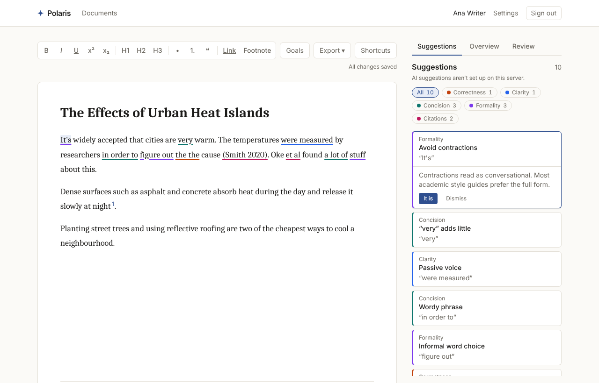

# Polaris

An open-source writing companion for academic writing. Polaris underlines issues as you write (contractions,
wordy phrases, passive voice, citation formatting, and more) and explains each one, so
students learn the conventions instead of just accepting fixes. An **Overview** describes the
draft with transparent writing metrics, and an optional **Review** by Claude gives formative
feedback on the whole document. Drafts come in from Word, Markdown or plain text, can carry
footnotes and links, and go out again as Word, Markdown, plain text or PDF.



## Getting started

```bash
npm install
cp .env.example .env
# Set AUTH_SECRET in .env: Auth.js signs session cookies with it, and will not start without it.
openssl rand -base64 32   # paste the output as AUTH_SECRET="…"
                          # (or run `npx auth secret`, which writes it to .env.local)
npm run db:migrate   # create the local SQLite database from prisma/migrations
npm run dev          # http://localhost:3000, then create an account at /signup
```

AI suggestions are optional: set `ANTHROPIC_API_KEY` in `.env` to offer them (see
[How feedback works](#how-feedback-works)). Without a key everything else works, and the editor
says that AI suggestions aren’t set up on this server.

`.env` is gitignored; `.env.example` lists every variable and is committed.

**Database changes are versioned migrations** (`prisma/migrations`): `npm run db:migrate`
(`prisma migrate deploy`) applies any that a database has not had yet, and is what production
and the Docker image run. `npm run db:push` still works for quick local experiments (it makes
the database match `prisma/schema.prisma` without recording a migration), but a database made
that way has no migration history.

Upgrading a local database from before migrations existed (one made with `db:push`)? Either
run `npm run db:push` once more (it only adds the new `User.sessionVersion` column, without
touching your documents) and keep using `db:push`, or move it onto migrations: run
`npm run db:push`, then `npx prisma migrate resolve --applied 20261017000000_init` (which
records that the first migration is already in place), and from then on `npm run db:migrate`.
Upgrading a local database created before accounts existed? Neither can add the required
`Document.userId` column to existing rows, so reset it with `npx prisma db push --force-reset`
(this deletes the local documents), then sign up again.

## Scripts

| Command              | What it does                                                                     |
| -------------------- | -------------------------------------------------------------------------------- |
| `npm run dev`        | Dev server                                                                       |
| `npm run build`      | Production build                                                                 |
| `npm start`          | Production server (after `build`)                                                |
| `npm test`           | Unit tests (Vitest)                                                              |
| `npm run test:e2e`   | End-to-end tests (Playwright, a fresh `prisma/e2e.db` a run, made by migrations) |
| `npm run lint`       | ESLint                                                                           |
| `npm run typecheck`  | TypeScript, no emit                                                              |
| `npm run db:migrate` | Apply pending migrations (`prisma migrate deploy`)                               |
| `npm run db:check`   | Fail if `prisma/schema.prisma` has changes no migration makes                    |
| `npm run db:push`    | Make a local database match the schema directly (quick experiments only)         |

`npm run test:e2e` needs no `.env`: Playwright gives the server a test-only `AUTH_SECRET` and
`AUTH_TRUST_HOST=true`, so it runs as is in CI. It builds the database with
`prisma migrate deploy`, so every run also checks that the migrations work.

**Changing the schema?** Edit `prisma/schema.prisma`, then add a migration for it: make a folder
`prisma/migrations/<YYYYMMDDHHMMSS>_<what-changed>/` and write the SQL with
`npx prisma migrate diff --from-migrations prisma/migrations --to-schema-datamodel prisma/schema.prisma --shadow-database-url file:./shadow.db --script > prisma/migrations/<that folder>/migration.sql`.
`npm run db:check` (also run in CI) fails until the two agree.

**CI** (`.github/workflows/ci.yml`) runs on every push and pull request: typecheck, lint, unit
tests, `db:check`, then the end-to-end tests in Playwright's Chromium; when something fails it
keeps the Playwright report as a build artifact. A second job builds the Docker image and
starts it with `docker compose` as in [Deploying](#deploying), and fails unless it becomes
healthy and runs under an init with no zombie processes.

## How feedback works

Polaris uses two layers:

1. **Rules (built).** Fast, deterministic checks in `src/lib/rules/` run on each paragraph
   as you type. Results are cached by paragraph text, so only the paragraph you are editing
   is rechecked. Code (code blocks and `inline code`) is not prose: neither layer flags
   anything in it, and the Overview counts its words but not its sentences. **Dismiss** hides
   that one suggestion, where it is: it stays hidden as you edit around it, and the same words
   elsewhere are still flagged.
2. **AI (built, opt-in).** Per-paragraph suggestions from Claude for what rules can't catch:
   hedging and overclaiming, unsupported claims, vague referents ("this", "it"), weak logical
   connections, awkward or ambiguous sentences, register slips and tense inconsistency. They
   show as cards with an **AI** badge and dashed underlines, next to the rule suggestions;
   where the two overlap, the rule's suggestion wins. Claude is told not to repeat what the
   rules already check, never to add facts or citations, and to prefer minimal edits; when a
   fix needs the writer's own judgement it explains what to do instead of offering a
   replacement. Nothing is ever applied without the writer choosing it.
   - **Off unless the writer turns it on.** Nothing is sent to Anthropic unless the writer
     switches on **AI suggestions** in Settings (checked against the database on every
     request) and the server has an Anthropic key. The same switch covers
     [reviews](#review): asking for a review sends the whole document (footnotes included), its
     title and the writing goals.
   - **What is sent, and when.** Only paragraphs the writer writes or changes: opening a
     document sends nothing. A paragraph of at least 8 words (and at most 4,000 characters) is
     sent to the Claude API once the writer has left it unchanged for 1.5 seconds, with the
     writing goals, the document title and the paragraph before it (as context, not to be
     reviewed). Editing one paragraph sends only that one, and text that was already checked
     (after an undo, say) is not sent again. A request is cancelled as soon as its paragraph
     changes again, at most two are in flight, and the paragraph edited last goes first. A
     request that fails is tried again after 30 seconds, then after longer waits. The Settings
     switch says all this before the writer turns it on. Polaris never logs paragraph text,
     prompts or Claude's output.
   - **Model.** `claude-opus-5-5` by default, at effort `low` (paragraph feedback runs often
     and should be quick). Responses use structured outputs and are checked before they are
     shown: at most 6 suggestions, each anchored to text that really is in the paragraph.
   - **Refusals.** Requests opt in to Anthropic's server-side refusal fallback
     (`fallbacks: "default"`): if the model declines a paragraph, the API retries it on a
     fallback model. If every model declines, the paragraph just gets no AI suggestions.
     Haiku models have no server-side fallback, so it is left off for them.
   - **Rate limits.** Per writer, in memory per server process: 30 requests a minute and 600
     a day. Answers served from the cache do not count. When a limit is reached, the editor
     pauses AI suggestions for as long as the server says, and says until when if it is more
     than a few minutes. The whole server also answers at most 20,000 paragraph requests a day
     (`POLARIS_AI_DAILY_PARAGRAPHS`), so many accounts together cannot run up an unbounded bill
     on the server's key; a request one writer's own limits refused does not count towards it.
   - **Caching.** The server keeps answers in memory for 24 hours (up to 2,000), keyed by a
     SHA-256 hash of the writer's account, model, effort, prompt version, goals, title,
     previous paragraph and paragraph text (one writer is never served another's answer, which
     would show that someone else sent the same paragraph); the browser keeps the session's
     answers by goals and text, so undoing back to text that was already checked costs
     nothing. The system prompt is marked for Anthropic's prompt caching.

   | Variable                      | Default           | What it does                                     |
   | ----------------------------- | ----------------- | ------------------------------------------------ |
   | `ANTHROPIC_API_KEY`           | (none)            | Enables AI suggestions. Stays on the server.     |
   | `POLARIS_AI_MODEL`            | `claude-opus-5-5` | The Claude model for suggestions and reviews.    |
   | `POLARIS_AI_PARAGRAPH_EFFORT` | `low`             | `low`, `medium` or `high`: depth versus latency. |
   | `POLARIS_AI_REVIEW_EFFORT`    | `high`            | `low` to `max`: effort for a [review](#review).  |
   | `POLARIS_AI_DAILY_PARAGRAPHS` | `20000`           | Paragraph requests a day for the whole server.   |
   | `POLARIS_AI_DAILY_REVIEWS`    | `500`             | Reviews a day for the whole server.              |

Suggestions fall into five categories: correctness, clarity, concision, formality and
citations. Citation rules follow the style chosen under **Goals** (APA by default).

The panel beside the editor has three tabs, **Suggestions | Overview | Review** (a WAI-ARIA
tablist: Left and Right move between tabs, Home and End go to the first and last). The browser
remembers the tab you last chose. Selecting an underline in the text always shows its card in
**Suggestions** (without changing the tab the browser remembers). On a phone the panel sits
below the editor.

## Overview

The **Overview** tab describes the draft with a few measures you can check by hand. They are
computed in the browser (nothing is sent anywhere), about 300 ms after you stop typing (or
after you turn a paragraph into a heading or back), and
there is deliberately no single overall score: each number answers one question, and none of
them says whether the writing is good.

| Measure          | What it is                                                                                                                                | Limits                                                                                                                                               |
| ---------------- | ----------------------------------------------------------------------------------------------------------------------------------------- | ---------------------------------------------------------------------------------------------------------------------------------------------------- |
| Words            | Every word, headings included (the footer's count). Footnotes are not counted.                                                            | A word is a run of letters or digits; "well-known" and "it's" are one word each.                                                                     |
| Sentences        | Sentences in paragraphs, split at `.`, `!` and `?` (not after "e.g.", "et al.", "Fig. 2", initials and the like).                         | Headings are not sentences. A list item without a full stop counts as one sentence.                                                                  |
| Paragraphs       | Non-empty blocks that are not headings (list items count).                                                                                |                                                                                                                                                      |
| Reading time     | Words ÷ 200 a minute.                                                                                                                     | A typical pace for academic prose; dense material reads slower.                                                                                      |
| Average sentence | Words per sentence.                                                                                                                       | Academic prose often averages 20 to 25 words; that is a guide, not a rule.                                                                           |
| Sentence variety | The standard deviation of sentence length, in words.                                                                                      | Near 0 means every sentence is about the same length.                                                                                                |
| Longest sentence | Its length in words; the button selects it in the text.                                                                                   | If you have rewritten it since, the panel says so.                                                                                                   |
| Reading ease     | Flesch Reading Ease: 206.835 − 1.015 × words per sentence − 84.6 × syllables per word, with Flesch's bands ("difficult" for 30 to 50).    | Made for general prose. Academic writing usually scores as difficult, and that is normal. Shown from 100 words. Syllables are estimated (see below). |
| Grade level      | Flesch–Kincaid Grade: 0.39 × words per sentence + 11.8 × syllables per word − 15.59, roughly a US school grade (13 and up is university). | Like reading ease, it measures only word and sentence length, not ideas or clarity.                                                                  |
| Passive voice    | The share of sentences in which the passive-voice rule finds a passive ("was measured", "were chosen by").                                | The same heuristic as the rule: it can miss a passive with an unusual participle, and passive is often right in a methods section.                   |
| Word variety     | MATTR (moving-average type-token ratio): the share of different words in every run of 50 words, averaged; plain TTR under 50 words.       | Unlike plain TTR it does not fall just because a text is longer. Repeating key terms is normal in academic writing and lowers it.                    |
| Repeated openers | First words that open 3 or more sentences, the 3 most frequent, with counts.                                                              | Case is ignored. "The" opening many sentences is common; the count is a prompt to look, not a fault.                                                 |
| Suggestions      | What is underlined now in each category (rule and AI suggestions, minus dismissed ones), with a rate per 1,000 words.                     | Counts, not a grade: one long sentence and one typo count the same. The bars are decoration; the numbers carry the meaning.                          |

Syllables are counted with a heuristic, as every readability tool does: groups of vowels,
corrected for a silent final "e" (but not "-le" after a consonant), silent "-es" and "-ed"
endings, a silent "e" before "-ly", "-ment" and similar suffixes, and "ia"/"io" said as two
syllables except in "-tion" and its kin. It is off by one on some words ("created",
"science"), which mostly evens out over a document (`src/lib/text/metrics.ts`).

**Target length.** Set **Target length (words)** under **Goals** (a whole number from 50 to
200,000; optional). The Overview then shows a progress bar with the count in words, such as
"1,240 of 2,000 words (62%)", and the footer shows "1,240 / 2,000 words". Going over the target
is shown as plainly as falling short of it. The target is saved with the other goals, and
reviews mention it only when a draft is far from it.

## Review

The **Review** tab asks Claude for formative feedback on the whole document, written as an
experienced academic-writing instructor would give it: specific, kind and honest, grounded in
your text, without rewriting it or inventing sources. A review has:

- a two- or three-sentence summary of what the document argues, and an assessment of the thesis;
- up to 5 **priorities**, most important first, each with a category (structure, argument,
  evidence, clarity, style or citations) and usually a short quote: selecting the quote finds
  that passage in your text as it is now and selects it (or says "(this passage has changed)");
- up to 4 strengths, up to 8 notes on particular paragraphs or sections (selecting a paragraph
  number jumps to it), and a few sentences each on structure, argument, evidence and style.

Every quote is checked against the reviewed text on the server; a quote that is not really in
it is dropped (the point it belongs to is kept). Nothing is ever applied to your text.

- **What is sent, and when.** Only when you select **Review document** (or **Review again**),
  only with **AI suggestions** switched on in Settings (checked against the database), and only
  if the server has an Anthropic key. Polaris first saves your latest edits, then sends to the
  Claude API: the whole document as saved (every paragraph, numbered `[P1]`, `[P2]`…, its
  headings, also listed as an outline, and its footnotes, marked `[^1]` in the text and listed
  at the end), its title, your writing goals (document type, audience,
  formality, citation style, target length) and its word and paragraph counts. The text is
  marked as the student's writing, to be reviewed and never followed as instructions. Opening
  the tab sends nothing to Claude: it only loads the last saved review from Polaris itself.
- **Length.** From 150 to 60,000 words (and at most 600,000 characters), counted on exactly
  the text that would be sent (footnotes count towards the characters, not the words).
- **Saved with the document.** Polaris keeps the 5 newest reviews of each document (deleted with
  the document or the account), with the model that answered, the prompt version, the word
  count and a SHA-256 hash of the reviewed text, block by block with which blocks are headings
  and the footnotes. When it no longer matches (you edited the text or a footnote, or turned a
  paragraph into a heading or back, which renumbers the paragraphs), the tab says "You have edited the document since this
  review." and offers **Review again**. **Review again** is also there under a review that is
  still current, for when you have changed your writing goals or the title.
- **Model.** The same model as paragraph suggestions (`POLARIS_AI_MODEL`, `claude-opus-5-5` by
  default) at effort `high` (`POLARIS_AI_REVIEW_EFFORT`: `low`, `medium`, `high`, `xhigh` or
  `max`). The answer is streamed (up to 64,000 output tokens, so a long document fits) and
  checked against a schema; counts and lengths are enforced after it arrives. The system
  prompt is marked for prompt caching. A review can take a minute or two; **Cancel** stops it,
  and nothing is saved.
- **Refusals.** As for paragraphs, the request opts in to the server-side refusal fallback
  (not for Haiku). If every model declines, the tab says that Claude declined to review the
  document, and the rest of Polaris carries on.
- **Rate limits.** Per writer, in memory per server process: 6 reviews an hour and 30 a day,
  and 500 a day for the whole server (`POLARIS_AI_DAILY_REVIEWS`). Requests refused before
  reaching Claude (too short, AI off) do not count. When a limit is reached, the tab says when
  you can ask again, or that the server's allowance for the day is used up.
- **Privacy.** Polaris never logs document text, prompts or Claude's output; a failed call
  logs only a fixed label, the HTTP status and Anthropic's request id.

## Footnotes and links

- **Footnotes.** **Footnote** in the toolbar (or Ctrl+Alt+F, Cmd+Alt+F on a Mac) puts a
  footnote at the cursor and opens a dialog for its text (plain text, up to 2,000 characters):
  **Save**, **Delete** or **Cancel** (Cancel on a new, empty footnote takes it out again), and
  focus goes back to the text after the marker. Markers show as superscript numbers in document
  order and renumber as you add, move or delete footnotes. Click a marker, or select it with the
  arrow keys and press Enter, to edit it. Under the document a **Footnotes** list shows them in
  order; each entry links back to its marker and has an **Edit** button, and each marker is
  described by its footnote's text for screen readers. Undo and redo work as for any edit: one
  undo takes out a footnote you just added.
- **What footnotes count for.** Footnote text is not part of your prose: the word count, the
  Overview's measures, the saved plain text, the rule-based suggestions and AI paragraph
  suggestions all leave it out (Claude is sent each paragraph without its markers). A
  [review](#review) does read them: they are sent as a numbered list at the end of the
  document, and editing a footnote makes a review stale.
- **Links.** Select text and choose **Link** (or Ctrl+K / Cmd+K) to add, change or remove a link;
  an empty address removes it, and with nothing selected the address itself is added as linked
  text. Web addresses typed or pasted into the text become links on their own. Only `http`,
  `https` and `mailto` links are allowed, whether typed, pasted or imported (`javascript:`,
  `data:`, protocol-relative `//…` and the like are refused); "example.com" gets `https://`. A
  plain click puts the cursor in a link so you can edit its text; Ctrl-click (Cmd-click) opens it
  in a new tab. Links open with `rel="noopener noreferrer nofollow"`.

## Your documents and the keyboard

- **The library** (`/`) lists your documents with a **Search documents** box, which filters by
  title and by the start of each document's text as you type (case and accents ignored; every
  word must match), says how many it shows ("2 of 14 documents"), and **Sort by**: Last edited,
  Title A-Z or Word count (longest first). The browser remembers both; the search only for your
  account, and it forgets it when you sign out, so the next person on a shared computer does not
  see what you searched for.
- **The tab title** is the document's title ("Climate essay · Polaris"), kept up to date as you
  type it.
- **Saving** is automatic, a moment after you stop typing. A save that fails (the network
  dropped, the server restarted) is tried again after 2, 5, 15, 30 and then every 60 seconds,
  without another edit, and the status says "Couldn’t save. Retrying…" meanwhile. Until then
  this tab also keeps your unsaved edits in the browser's session storage: if the page is
  reloaded before they are saved, the document offers **Restore my edits** or **Discard**.
- **Two tabs or devices.** Every save carries the version of the document it was made from,
  and the server refuses one made from an older version (409) rather than overwrite the newer
  text. A tab that comes back into view first asks for the current version and, with nothing
  unsaved, loads the newer text. With unsaved edits it says the document was changed
  somewhere else and offers **Keep this version** (save yours over it) or **Load the saved
  version**. Signing out first tries to save, and asks before signing out if it cannot.
- **Leaving with unsaved changes** (an edit not yet saved, being saved, or whose save failed)
  makes the browser ask first; at any other time it does not.
- **Limits per account:** 1,000 documents and 200 million stored characters (a long thesis is
  well under a million), 120 new documents an hour and 240 saves a minute. One document holds
  up to 5 million characters (counted as stored, formatting included).
- **First-run help.** A new, empty document shows a short "How Polaris works" card under the
  toolbar until you choose **Got it**; the browser remembers that. (On a server without an
  Anthropic key it says AI is not set up, rather than pointing to Settings.)
- **Keyboard.** **Alt+]** and **Alt+[** (Option on a Mac) move to the next and previous
  suggestion: the flagged words are selected in the text and their card opens. They are the two
  keys to the right of P, whatever your layout prints on them, and never a key that types a
  bracket: where Alt (Option) is how you type "[" or "]" (a German or Spanish Mac, say), the
  bracket is typed. **Escape** closes
  the card and puts you back in the text. **Shortcuts** in the toolbar, or **Shift+?** anywhere
  outside a text field, lists every shortcut (formatting, headings and lists, undo, links,
  footnotes and these), with the keys named for a Mac or for Windows and Linux.

## Import

**Import** in the library (or dropping a file on it) makes a new document from a file of up to
10 MB. The file is converted **in your browser** and never uploaded; only the document it becomes
is saved, through the same API as any other document. A file that cannot be read shows an error
and creates nothing.

| Format                    | Kept                                                                                                                                                                                                          | Left out (and counted)                                                                               |
| ------------------------- | ------------------------------------------------------------------------------------------------------------------------------------------------------------------------------------------------------------- | ---------------------------------------------------------------------------------------------------- |
| Word (.docx)              | Title, headings 1–3 (4–6 become 3), paragraphs, bold, italic, underline, strikethrough, superscript and subscript, bulleted and numbered lists (nested), quotes, links, footnotes and endnotes (as footnotes) | Images, tables, equations, comments, deleted text from tracked changes (insertions are kept as text) |
| Markdown (.md, .markdown) | GitHub-flavoured Markdown: headings, emphasis, strikethrough, code, lists (nested), quotes, links, `[^1]` footnotes with their `[^1]: …` definitions                                                          | Images and tables. Raw HTML is not trusted: it is kept as visible text, never as markup.             |
| Plain text (.txt)         | Paragraphs (separated by blank lines; single line breaks inside one are soft wrapping); a file with no blank lines gets one paragraph per line                                                                |                                                                                                      |

The title comes from Word's Title style or a level-1 heading that starts the document (taken
out of the body; one further in, a chapter say, stays where it is), else from the file name. A
title is plain text, so a footnote on it moves to a paragraph of its own at the start of the
text. A footnote longer than 2,000 characters is shortened. When something was left out,
shortened or moved, the new document says so once, for example "2 images and 1 table were left
out." Every format is turned into HTML that is parsed
with `DOMParser` into a detached document (never inserted into the page), stripped of scripts,
styles, frames, forms and every `on*` and `style` attribute, and then read with the editor's own
schema, so anything the editor cannot show is dropped. Old Word files (.doc) are not supported:
save them as .docx first.

## Export

**Export** in the editor's toolbar exports exactly what the editor shows, named after the title
(`climate-essay.docx`; "untitled" without one):

- **Word (.docx):** the title in Word's Title style, Heading 1–3, bold, italic, underlined,
  struck-through, superscript and subscript text, nested bulleted and numbered lists, quotes in an indented Quote style, line breaks, real
  hyperlinks and real Word footnotes, in 12 pt Times New Roman with 1.5 line spacing.
- **Markdown (.md):** CommonMark with everything you typed escaped, nested lists, quotes, links,
  hard breaks, and footnotes as `[^1]` with their definitions at the end. Importing the file
  again gives back the same text (underline, superscript and subscript aside: Markdown has
  none). Where Markdown could not
  read formatting back (bold that ends in punctuation right before a letter, as in `Note:` +
  `text`, or in Chinese and Japanese text), that formatting is left off and the text kept.
- **Plain text (.txt):** paragraphs separated by blank lines, list markers kept, footnotes as
  `[1]` in the text and a numbered list at the end.
- **Print / Save as PDF:** the browser's print dialog, with a print stylesheet that shows only
  the title and the document (no navbar, toolbar, side panel or suggestion underlines) in the
  serif font, with page margins, no page break straight after a heading, and the footnotes as a
  numbered list at the end. Choose "Save as PDF" as the printer for a PDF.

## Data export

**Settings → Your data → Download all my documents** downloads a .zip with one Markdown file
per document (named after its title, made unique: `essay.md`, `essay-2.md`) and a
`manifest.json` listing each document's file, title, creation and last-edit dates, word count
and writing goals. Saved reviews and suggestions are not included. The zip is put together in
the browser from `GET /api/documents/export`, which returns the signed-in user's documents with
their content 20 at a time (fewer when they are long: a page stops at about 8 million
characters), so even hundreds of long documents never make one slow or huge request. A user can
ask for 300 pages an hour.

## Accounts

Each writer has an account, and documents are private to it.

- **Sign-in** is email and password ([Auth.js v5](https://authjs.dev), Credentials provider).
  Emails are stored trimmed and lowercased; passwords (8–128 characters) are hashed with
  bcrypt, cost 12. A wrong password and an unknown email get the same message and take the
  same time, so the form does not reveal who has an account.
- **Sessions** are signed, encrypted JWT cookies (30 days), so there is no session table.
  Signing out clears the cookie on that device. **Changing the password signs out every other
  device**, and so does **Settings → Signed-in devices → Sign out of all other devices** (up to
  5 times in 15 minutes); the device you do it from stays signed in. Deleting the account signs
  out every device too, as their requests then find no user. A document left open on a device
  that was signed out says so as soon as it next tries to save, with a link to sign in again in
  a new tab; once you have, your next edit there saves everything since.
- **How revocation works.** Each user has a `sessionVersion` number, and each session's JWT
  carries the version it was issued with. Every API request and every page load checks it
  against the database (they already load the user), so a session issued before the version
  went up is treated as signed out: an API call gets 401, and a page load clears the cookie and
  goes to the sign-in page. A password change or "Sign out of all other devices" raises the
  version and, in the same request, re-issues this device's JWT with the new version (Auth.js's
  `unstable_update`). The raise is a compare-and-swap from the version the asking session was
  checked against, so a session revoked a moment earlier (a stolen cookie racing its owner) is
  refused rather than re-issued past the revocation. Only that server request can do this: Auth.js also lets any browser ask
  to update its own session (`POST /api/auth/session`), but Polaris ignores what such a request
  asks for, so a signed-out device cannot sign itself back in. Sessions from before versions
  existed count as version 0, so upgrading signs nobody out.
- **Privacy.** Every API route calls `requireUser()` and every query is scoped by user id. Another
  writer's document is a 404, exactly like one that does not exist.
- **Rate limits** (in memory, per server process, sliding windows): 10 sign-in attempts per
  15 minutes per email and IP, plus at most 50 an hour per email from any number of IPs, and
  30 per 15 minutes per IP whatever the email (when client IPs are known, below); 5 sign-up
  attempts per hour per IP (counted once the form is valid, so a whole class signing up
  behind one school network will hit it); 10 password-change attempts per 15 minutes per
  account. Checking a password is deliberately slow (about a third of a second of CPU), so at
  most 4 run at once; an attempt beyond that is told to try again in a moment rather than
  queued, and the rest of the server stays responsive.
- **Who can sign up.** Anyone, by default. `POLARIS_SIGNUP=closed` stops new accounts (the
  sign-up page says so, and existing accounts sign in as before); create accounts first, then
  close it. `POLARIS_SIGNUP_EMAIL_DOMAINS=uni.edu,college.ac.uk` allows only emails at those
  domains or their subdomains, and the sign-up page says which.
- **Client IPs and proxies.** Polaris can only tell clients apart by IP when a reverse proxy
  you control reports their address. Without one, `X-Forwarded-For` is whatever the client sent,
  so it is ignored and **all clients share the per-IP limits** (5 sign-ups an hour for the
  whole server, 10 sign-in attempts per email). Behind nginx, Caddy or a load balancer that
  appends the client address to `X-Forwarded-For`, set `TRUSTED_PROXY_HOPS` to the number of
  such proxies (usually `1`), and make sure clients cannot reach Polaris except through them.
- **Settings** (`/settings`): display name, the AI suggestions switch (off by default), a data
  export, password change, signing out of all other devices, and account deletion (type your
  email to confirm; your documents are deleted too).

When self-hosting behind a proxy, keep `AUTH_TRUST_HOST=true` only if the proxy sets the `Host`
and `X-Forwarded-Host` headers itself; otherwise set `AUTH_URL` to the public URL.

### Adding an OAuth provider

The config is split so this stays small. `src/auth.config.ts` is edge-safe (middleware imports
it); `src/auth.ts` adds what needs Node (Prisma, bcrypt) and merges in the providers listed in
`auth.config.ts`. To add GitHub, say:

1. Register an OAuth app with the callback URL `https://<your-host>/api/auth/callback/github`, and
   set `AUTH_GITHUB_ID` and `AUTH_GITHUB_SECRET` (Auth.js reads `AUTH_<PROVIDER>_ID/SECRET`).
2. Add the provider to `providers` in `src/auth.config.ts`: `providers: [GitHub]`, imported from
   `next-auth/providers/github`. OAuth providers need no database, so they are edge-safe.
3. Map the OAuth identity to a Polaris user. Polaris keeps its own `User` table rather than an
   Auth.js adapter, so in `src/auth.ts` override the `jwt` callback: when
   `account?.provider !== "credentials"`, find or create the `User` by the provider's email
   (only if the provider marks it verified) and set `token.id` to that user's id. Make
   `passwordHash` optional in `prisma/schema.prisma` for OAuth-only users, and have
   `verifyCredentials` treat a missing hash as a wrong password. To link accounts by provider
   id rather than email, add an `Account` model (`provider`, `providerAccountId`, `userId`),
   or switch to `@auth/prisma-adapter`.
4. Add a "Continue with GitHub" button to `/signin`: a form whose server action calls
   `signIn("github", { redirectTo })`, with `redirectTo` passed through `sanitizeCallbackUrl`.

## Security headers

Every response (pages, API routes, static files) carries `X-Content-Type-Options: nosniff`,
`Referrer-Policy: strict-origin-when-cross-origin`, `X-Frame-Options: DENY`,
`Permissions-Policy: camera=(), microphone=(), geolocation=(), interest-cohort=()` and
`Cross-Origin-Opener-Policy: same-origin` (`next.config.ts`), and no `X-Powered-By`.

Pages also get a **Content-Security-Policy** with a fresh nonce for every response, set in
`src/middleware.ts` (`src/lib/security/headers.ts` builds it):

```
default-src 'self'; script-src 'self' 'nonce-…' 'strict-dynamic'; style-src 'self' 'unsafe-inline';
img-src 'self' data: blob:; font-src 'self' data:; connect-src 'self'; object-src 'none';
base-uri 'self'; form-action 'self'; frame-ancestors 'none'
```

Next.js puts the nonce on the scripts it renders, and `'strict-dynamic'` lets them load the
code they import (the editor, the import and export converters); no other script, inline or
from elsewhere, runs. Inline styles are allowed (React's style attributes and TipTap's injected
stylesheet use them; styles cannot run code). Nothing is loaded from another site, and Polaris
cannot be framed. In development the policy also allows `'unsafe-eval'` and `ws:`, which React's
fast refresh and the dev server need, and nothing else. Because of the nonce every page is
rendered per request. An end-to-end test (`e2e/security.spec.ts`) goes through signing up,
editing, footnotes, links, importing, exporting, the panel tabs and Settings, and fails on any
CSP violation.

**Requests.** API routes that take a body accept only `Content-Type: application/json` (415
otherwise), which a form on another site cannot send, and every route that changes something
refuses a request the browser marks as cross-site (`Sec-Fetch-Site`, 403), on top of the
session cookie's `SameSite=Lax` (Auth.js's own sign-in and sign-out endpoints check its CSRF
token). Bodies are read with a cap and refused (413) as soon as they pass it: 16 KB for
settings, password and sign-in requests, 160 KB for a paragraph sent for AI suggestions, and
32 MB for saving a document.

`Strict-Transport-Security` (one year, with subdomains) is sent only with `POLARIS_HSTS=1`. It
tells browsers to refuse plain HTTP to the host for that year, so set it only once Polaris is
served over HTTPS (behind a reverse proxy, say): on a plain-HTTP install it would lock everyone
out. Next.js writes `next.config.ts`'s headers into the build, so `POLARIS_HSTS` is read when the
app is **built**: rebuild after changing it (`docker compose up -d --build` does).

## Deploying

Polaris is a single Node.js server with a SQLite file, so the simplest deployment is one
container:

```bash
git clone https://github.com/vincecarlmoncada285-star/Polaris.git && cd Polaris
cp .env.example .env
# In .env: AUTH_SECRET (openssl rand -base64 32), and AUTH_URL or AUTH_TRUST_HOST (below).
docker compose up -d --build
curl http://localhost:3000/api/health   # {"ok":true}
```

The image (`Dockerfile`: multi-stage, `node:22-slim`, runs as the unprivileged `node` user)
keeps the database at `/data/polaris.db` on the `polaris-data` volume, applies any pending
migrations (`prisma migrate deploy`) every time it starts, then runs `next start` on port 3000.
`docker-compose.yml` runs it with Docker's init as PID 1 (`init: true`), which passes on the
stop signal and reaps orphaned processes; if you run the image without Compose, pass `--init`
to `docker run` for the same.
Docker's `HEALTHCHECK` calls `GET /api/health`, which needs no session, is not rate limited,
and answers `{"ok":true}` (200) when the database responds to a trivial query within 3 seconds,
or `{"ok":false}` (503) otherwise, with no other detail. Point your load balancer or uptime
monitor at it too.

| Variable                                                                      | Needed?          | What it does                                                                                                                                                                                            |
| ----------------------------------------------------------------------------- | ---------------- | ------------------------------------------------------------------------------------------------------------------------------------------------------------------------------------------------------- |
| `AUTH_SECRET`                                                                 | Yes              | Signs and encrypts session cookies. Keep it secret and stable: changing it signs everyone out.                                                                                                          |
| `AUTH_URL`                                                                    | One of these two | The public URL, e.g. `https://polaris.example.edu`.                                                                                                                                                     |
| `AUTH_TRUST_HOST`                                                             | One of these two | `true` to trust the `Host` and `X-Forwarded-Host` headers instead; only if your proxy sets them itself.                                                                                                 |
| `TRUSTED_PROXY_HOPS`                                                          | Behind a proxy   | How many reverse proxies append the client address to `X-Forwarded-For` (usually `1`), so per-IP rate limits see real clients ([Accounts](#accounts)). Leave `0` if clients can reach Polaris directly. |
| `ANTHROPIC_API_KEY`                                                           | For AI           | Enables AI suggestions and reviews ([How feedback works](#how-feedback-works)).                                                                                                                         |
| `POLARIS_AI_MODEL`, `POLARIS_AI_PARAGRAPH_EFFORT`, `POLARIS_AI_REVIEW_EFFORT` | No               | Model and effort for AI suggestions and reviews.                                                                                                                                                        |
| `POLARIS_AI_DAILY_PARAGRAPHS`, `POLARIS_AI_DAILY_REVIEWS`                     | No               | Whole-server daily caps on AI requests (defaults 20,000 and 500), which bound what the Anthropic key can spend in a day.                                                                                |
| `POLARIS_SIGNUP`, `POLARIS_SIGNUP_EMAIL_DOMAINS`                              | No               | `closed` stops new accounts; a comma-separated domain list limits who can sign up ([Accounts](#accounts)).                                                                                              |
| `POLARIS_HSTS`                                                                | Once on HTTPS    | `1` sends `Strict-Transport-Security` ([Security headers](#security-headers)). Read at build time.                                                                                                      |
| `DATABASE_URL`                                                                | No               | Set by the image to `file:/data/polaris.db`; `docker-compose.yml` keeps it there whatever `.env` says.                                                                                                  |

- **HTTPS.** Polaris itself speaks plain HTTP on port 3000. Put a reverse proxy in front for
  HTTPS (Caddy does it with one line: `polaris.example.edu { reverse_proxy localhost:3000 }`;
  nginx and most load balancers work too), make port 3000 reachable only from the proxy (in
  `docker-compose.yml`, change the port to `"127.0.0.1:3000:3000"` when the proxy runs on the
  same machine), set `TRUSTED_PROXY_HOPS=1`, and either `AUTH_URL` or `AUTH_TRUST_HOST=true`.
  Then set `POLARIS_HSTS=1` and rebuild.
- **Backups.** Everything is in one SQLite file. Either copy it while Polaris is stopped
  (`docker compose stop`, `docker compose cp polaris:/data/polaris.db ./polaris-backup.db`,
  `docker compose start`), or take a consistent copy while it runs with SQLite's online backup,
  from the host: `sqlite3 "$(docker volume inspect -f '{{.Mountpoint}}' polaris_polaris-data)/polaris.db" ".backup polaris-backup.db"`.
  Do not copy the file of a running server any other way: the copy can be torn mid-write. To
  restore, stop Polaris and put the copy back as `/data/polaris.db`.
- **Upgrading.** `git pull`, then `docker compose up -d --build`. The new image applies any new
  migrations when it starts; your data stays on the volume.
- **Without Docker.** Node 22: `npm ci`, `npm run build`, then `npm run db:migrate` and
  `npm start` with the variables above in the environment (and `DATABASE_URL` pointing at a file
  that lives outside the checkout).
- **More than one server** needs a shared database (switch the Prisma provider to PostgreSQL)
  and shared rate limits (they are in memory, per process); SQLite suits one server.

## Privacy

What Polaris stores and sends, in one place:

- **Stored** in its database: your account (email, display name, a bcrypt hash of your
  password, your AI setting), your documents (title, text, writing goals) and up to 5 saved
  reviews per document. Deleting a document deletes its reviews; deleting your account deletes
  everything. **Settings → Your data** downloads all your documents.
- **In your browser only:** the panel tab you last chose, the library's search (for your
  account only, forgotten when you sign out) and sort, and whether you dismissed the first-run
  help (localStorage); edits a tab could not save yet (sessionStorage: that tab only, gone
  when it closes, and cleared when you sign out); imported files are converted in the
  browser and never uploaded.
- **Sent to Anthropic** only if you switch on AI suggestions and the server has a key:
  paragraphs you write or change (for suggestions), and the whole document with its title,
  footnotes and goals when you ask for a review. See [How feedback works](#how-feedback-works)
  and [Review](#review).
- **Never logged:** document text, prompts and Claude's output. Polaris loads nothing from other
  sites (its [Content-Security-Policy](#security-headers) would block it), and sets no tracking
  or analytics cookies: the only cookies are Auth.js's session and CSRF cookies.

## Roadmap

- [x] Phase 1: editor, document CRUD, autosave
- [x] Phase 2: rule engine, underlines, suggestion cards, writing goals
- [x] Phase 6 (built early, so the AI routes are written auth-aware): accounts, private
      per-user documents, settings. The database stays SQLite, which suits a single self-hosted
      server; for serverless hosting, whose filesystem does not persist, change `provider` in
      `prisma/schema.prisma` to `"postgresql"` and point `DATABASE_URL` at a Postgres server.
- [x] Phase 3: LLM suggestions (schema-validated, cached, cancellable)
- [x] Phase 4: overview panel: transparent writing metrics, suggestion counts and a word target
      (no single overall score, by design)
- [x] Phase 5: whole-document review by Claude (structured, saved per document, quotes that
      jump back into the text)
- [x] Phase 7, part 1: footnotes, links, import (.docx, Markdown, plain text), export (.docx,
      Markdown, plain text, print / PDF) and a data export of every document
- [x] Phase 7, part 2: session revocation, security headers (a nonce-based CSP), polish (library
      search and sort, tab titles, an unsaved-changes guard, keyboard navigation between
      suggestions and a shortcuts dialog, error and loading pages, first-run help, a site
      footer, an icon) and self-hosting (health check, versioned migrations, Docker, CI)
